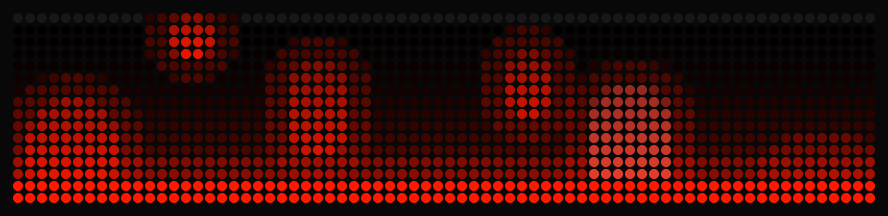
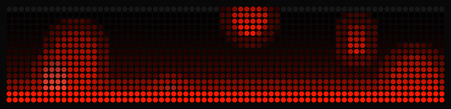
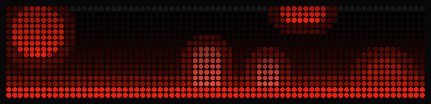
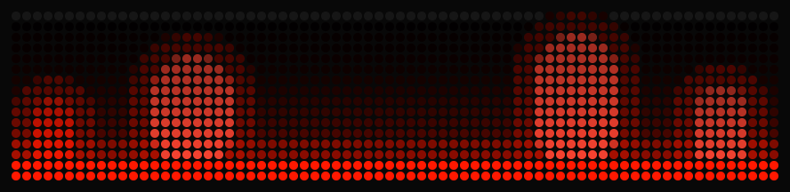
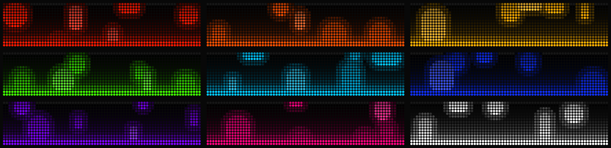
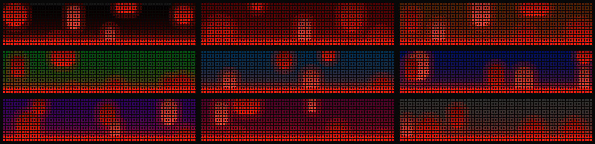

# Lava Lamp

An interactive lava lamp for the [BUSY Bar](https://busy.app). Warm wax rises from the pool, cools at the top and sinks back. Push it down with the big button, stir it with the scroll wheel, or turn off the heater with OK button and watch it settle.

## Install

You need BUSY Bar firmware 1.3.1 or later.

1. Download `io.filipesilva.lava-lamp-<version>.tgz` from the [latest release](https://github.com/filipesilva/busybar-lava-lamp/releases/latest).
2. Connect the BUSY Bar to your computer by USB and open [http://10.0.4.20](http://10.0.4.20). Over Wi-Fi, use the bar's address on your network instead.
3. Go to the **Apps** tab and click **＋Add app**.
4. Click **Select file**, choose the `.tgz` file, and click **Upload**.
5. Click **Install app**. If an older version is installed, the button says **Update app**.

See [Install apps](https://docs.busy.app/bar/dev/js-apps) and [Manage apps](https://docs.busy.app/bar/apps-and-integrations/manage-apps) in the BUSY docs for more.

## Controls

### Push

Hold **Start / Pause**, the big button on top, to push the lava down for as long as you hold it. A tap gives it a shove. Shown held for 5 seconds.

### Shear

Turn the **scroll wheel** to shear the top of the lava sideways. Clockwise shears it to the right. Shown with eight quick clicks clockwise.

### Heater

Press **OK** to turn the heater off or on. With the heater off, the wax cools and settles into the pool. Shown off for 12 seconds, then back on.

### Quit

Press **Back**.

## Settings

Change them on the bar or in the web interface. New values apply the next time the app starts.

### Lava

Red (default), orange, yellow, lime, cyan, blue, purple, pink or white. Shown on the black background.

### Background

Black (default), or a dark red, orange, green, cyan, blue, purple, pink or grey. The bottom of the lamp is lit by the lava colour. Shown with red lava.

### Speed

Very slow, slow, normal (default), fast or very fast.

## Development

See [DEVELOPMENT.md](./DEVELOPMENT.md) for building, testing on the bar, the tools, and the template reference.

## License

[MIT](./LICENSE)
